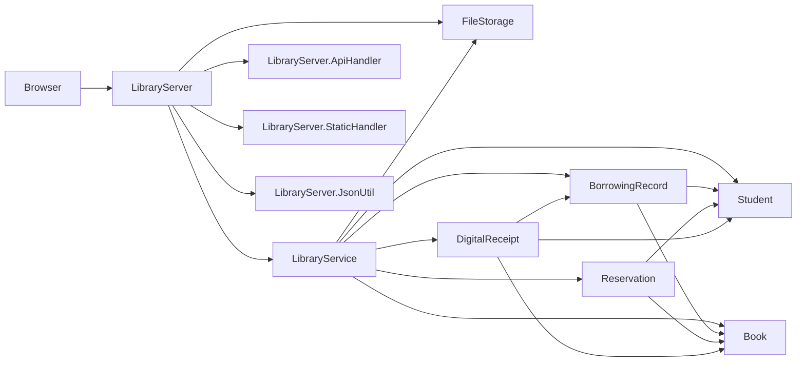

# 1.05 Sketch the Classes with CRC Cards

| | |
|---|---|
| **Project** | Online Library System |
| **Task** | 1.05 Sketch the Classes with CRC Cards (3 points, Must) |

## How to read this document

Each card has three parts:

- **Class:** the name and its one-sentence job.
- **Responsibilities:** what the class knows and does to carry out that job.
- **Collaborators:** the other classes it works with.

**Extension point** marks where a future type or rule could be added and explains where it belongs.

---

## 1. Changes from the project guide

The proposal's section 8 lists eight main classes. I compared them with the Java source and kept those classes because each is present in the implementation. The class diagram also shows three nested types inside `LibraryServer`; cards for these supporting types are included because they appear in the diagram.

| Change | Class | Reason |
|---|---|---|
| Kept | `LibraryServer`, `LibraryService`, `FileStorage`, `Student`, `Book`, `BorrowingRecord`, `Reservation`, `DigitalReceipt` | Each appears in the proposal and has a corresponding Java class. |
| Included from the class diagram | `LibraryServer.ApiHandler`, `LibraryServer.StaticHandler`, `LibraryServer.JsonUtil` | These nested interface/helper types are shown in the class diagram and have separate request-handling or JSON responsibilities. |
| External dependency, not a project class | `HttpHandler` (JDK) | The class diagram shows this JDK interface because `StaticHandler` implements it; it is an existing library type, not a class the project defines. |
| No separate class yet | Penalty, policy/settings | Penalty data and checks currently live in `BorrowingRecord`, `Reservation`, and `LibraryService`. The current scope does not need separate classes for them; extension points below show where they could be added. |

---

## 2. Class list at a glance

| # | Class | One clear job |
|---|---|---|
| 1 | `LibraryServer` | Serve the web interface and route HTTP requests to the library operations. |
| 2 | `LibraryService` | Apply library rules and coordinate catalog and student transactions. |
| 3 | `FileStorage` | Load and save the system's persistent data file. |
| 4 | `Student` | Represent a registered student's identity and profile details. |
| 5 | `Book` | Represent a catalog book and its copy availability. |
| 6 | `BorrowingRecord` | Record one borrowing from checkout through return, extension, or loss. |
| 7 | `Reservation` | Record one student's reservation and its status and expiry. |
| 8 | `DigitalReceipt` | Present a saved summary of a borrowing transaction. |
| 9 | `LibraryServer.ApiHandler` *(nested interface)* | Define the handler shape used for API requests. |
| 10 | `LibraryServer.StaticHandler` *(nested class)* | Serve static website files. |
| 11 | `LibraryServer.JsonUtil` *(nested class)* | Convert response data to JSON text. |

---

## 3. CRC cards

### Application coordination

#### Card 1: `LibraryServer`

**Job:** Connect browser requests to the library system and return pages or API responses.

| Responsibilities | Collaborators |
|---|---|
| Start the HTTP server and connect API and static-file handlers | `StaticHandler`, `ApiHandler` (nested) |
| Keep shared storage and service instances available to request handlers | `FileStorage`, `LibraryService` |
| Return JSON responses | `JsonUtil` (nested) |
| Pass library actions to the business-logic layer | `LibraryService` |

> **Extension point: new API operation.** Add its request routing and HTTP response handling in `LibraryServer`, then delegate the library decision to `LibraryService`. Keep rule checks out of the HTTP handler.

#### Card 2: `LibraryService`

**Job:** Apply the library's business rules and coordinate changes to library data.

| Responsibilities | Collaborators |
|---|---|
| Register students and manage in-memory sign-in sessions | `Student`, `FileStorage` |
| Search the catalog and report book information | `Book` |
| Validate and coordinate borrowing, returning, extending, reserving, canceling, and reserved-book checkout | `Student`, `Book`, `BorrowingRecord`, `Reservation` |
| Create and retrieve borrowing receipts and transaction history | `DigitalReceipt`, `BorrowingRecord` |
| Check reservation expiry and calculate or record penalties | `Reservation`, `BorrowingRecord` |
| Record lost books and simulated penalty settlement | `BorrowingRecord`, `Reservation` |
| Load and persist system data | `FileStorage` |

> **Extension point: new transaction rule.** Put the validation and state change in `LibraryService`, beside the related workflow. If the rule adds persistent information, update the relevant model and `FileStorage` format as well.

#### Card 3: `FileStorage`

**Job:** Read and write the system's pipe-delimited data file.

| Responsibilities | Collaborators |
|---|---|
| Read saved data lines and write updated data | `LibraryService`, `LibraryServer` |
| Escape and unescape field values so delimiters and line breaks are stored safely | `LibraryService`, `LibraryServer` |
| Save through a temporary file before replacing the data file | `LibraryService`, `LibraryServer` |

> **Extension point: new persisted field or record.** Update the serialization and loading logic used by `LibraryService` together with the corresponding model. Preserve compatibility with existing `data/library-data.txt` records when changing the format.

### Library records

#### Card 4: `Student`

**Job:** Hold the profile details for one registered student.

| Responsibilities | Collaborators |
|---|---|
| Know student ID, full name, phone, terms agreement, and registration time | — |
| Provide access to the student's profile data | `LibraryService`, `FileStorage` |

> **Extension point: new profile detail.** Add the field to `Student` and update registration, profile responses, and `FileStorage` wherever that field is used.

#### Card 5: `Book`

**Job:** Hold one catalog book's details and current copy availability.

| Responsibilities | Collaborators |
|---|---|
| Know book ID, title, author, category, description, and cover color | — |
| Know total copies, available copies, and availability status | `LibraryService`, `BorrowingRecord`, `Reservation` |

**Current statuses:** Available, Borrowed, Reserved.

> **Extension point: new book status or copy rule.** Add a status to `Book.Status` and update the service logic that changes availability so searches and transactions use the same meaning.

#### Card 6: `BorrowingRecord`

**Job:** Keep the history and current state of one book borrowing.

| Responsibilities | Collaborators |
|---|---|
| Know record, student, and book IDs, borrow date, and due date | `Student`, `Book` |
| Track whether the loan was extended and whether it was returned or reported lost | `LibraryService` |
| Store return, damage, overdue, and lost-book penalty details | `LibraryService`, `FileStorage` |
| Link the borrowing to its receipt number | `DigitalReceipt` |

**Current statuses:** Active, Returned, Overdue, Lost.

> **Extension point: new borrowing outcome.** Add the status or fields to `BorrowingRecord`, then update the transaction rules in `LibraryService` and the persistence mapping in `FileStorage`.

#### Card 7: `Reservation`

**Job:** Keep the status and dates of one student's request to hold a book.

| Responsibilities | Collaborators |
|---|---|
| Know reservation ID, student ID, book ID, reserve date, and expiry date | `Student`, `Book` |
| Track whether the reservation is active, canceled, completed, or expired | `LibraryService` |
| Store the expired-reservation penalty and whether it was paid | `LibraryService`, `FileStorage` |
| Report whether the reservation is active | `LibraryService` |

**Current statuses:** Active, Canceled, Completed, Expired.

> **Extension point: new reservation rule.** Add the check to the reservation workflow in `LibraryService`. Put any new reservation-specific state on `Reservation` and persist it through `FileStorage`.

#### Card 8: `DigitalReceipt`

**Job:** Hold a readable, saved summary of one borrowing transaction.

| Responsibilities | Collaborators |
|---|---|
| Know receipt number, student and book details, author, and borrowing time | `Student`, `Book`, `BorrowingRecord` |
| Know due date, loan duration, status, and return date | `BorrowingRecord`, `LibraryService` |
| Provide receipt data for display and storage | `LibraryService`, `FileStorage` |

> **Extension point: new receipt detail.** Add it to `DigitalReceipt` and update receipt creation and persistence. Keep the receipt as a summary; the borrowing lifecycle remains the responsibility of `BorrowingRecord`.

### Supporting server types

#### Card 9: `LibraryServer.ApiHandler` (nested interface)

**Job:** Define the common request-handling operation used by API endpoint handlers.

| Responsibilities | Collaborators |
|---|---|
| Specify `handle(HttpExchange)` for an API request | `LibraryServer`, `HttpExchange`, `HttpHandler` (JDK) |

> **Extension point: new API handler implementation.** Implement this interface for the endpoint and pass it through `LibraryServer`'s wrapper so shared request handling stays consistent.

#### Card 10: `LibraryServer.StaticHandler` (nested class)

**Job:** Serve the website's static files over HTTP.

| Responsibilities | Collaborators |
|---|---|
| Resolve and serve files from the public web directory | `LibraryServer`, `HttpExchange`, `Files` |
| Choose a content type based on the requested file extension | `HttpExchange` |
| Reject unsafe paths and handle missing files | `HttpExchange`, `HttpHandler` (JDK) |

> **Extension point: new static file type.** Add its content type mapping to `guessMime()` in this handler.

#### Card 11: `LibraryServer.JsonUtil` (nested class)

**Job:** Convert supported Java response values into JSON text.

| Responsibilities | Collaborators |
|---|---|
| Convert strings, numbers, booleans, maps, iterables, and null values to JSON | `LibraryServer` |
| Escape string characters that have special meaning in JSON | `LibraryServer` |

> **Extension point: new JSON value type.** Add its conversion behavior in `JsonUtil.write()` and keep string escaping centralized in `quote()`.

---

## 4. Collaboration map

Arrows mean **uses or depends on**.

## 5. Where new types and rules slot in

| To add… | Change this | Collaborators / follow-up |
|---|---|---|
| A new student profile field | `Student` | Update registration, profile output, and `FileStorage`. |
| A new book status or copy rule | `Book` | Update availability changes and checks in `LibraryService`. |
| A new borrowing state or detail | `BorrowingRecord` | Update transaction handling in `LibraryService` and saved records in `FileStorage`. |
| A new reservation state or detail | `Reservation` | Update reservation handling in `LibraryService` and saved records in `FileStorage`. |
| A separate **`Penalty` type** | Add a new model to represent a charge and its payment state | `LibraryService` creates/checks penalties; `BorrowingRecord` or `Reservation` can refer to them; `FileStorage` saves them. This is optional—the current implementation stores penalty data on the relevant records. |
| Configurable loan or reservation limits | Add a **`LibraryPolicy`** or settings type | `LibraryService` reads the values instead of keeping those values in workflow logic. Current limits are enforced in `LibraryService`. |
| A new API route | `LibraryServer` | Delegate business decisions to `LibraryService`. |
| A new saved data field | Model plus `FileStorage` mapping | Update `LibraryService` loading and saving, and preserve existing file compatibility. |
